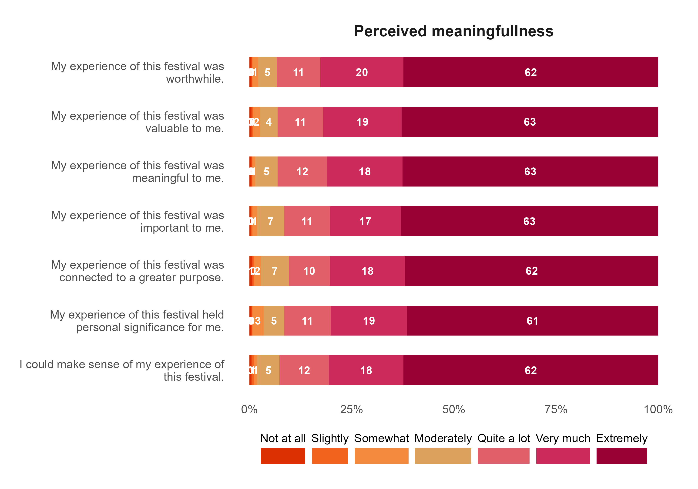
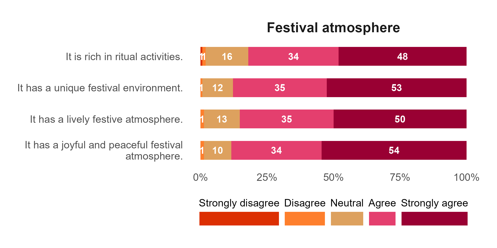
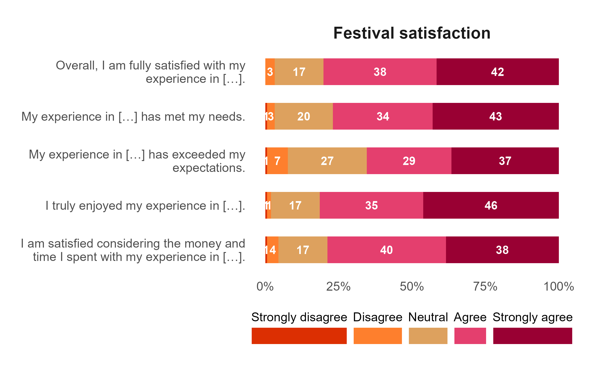
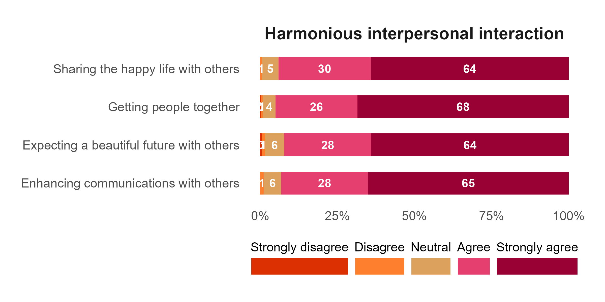
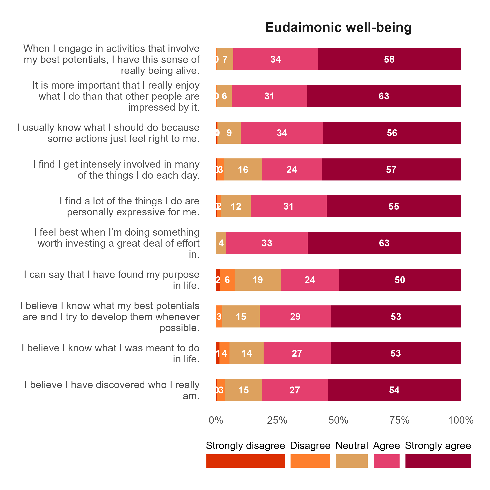

```{r}
#| echo: false
#| message: false
#| warning: false
# set working directory
setwd(here::here("didi-festival"))

# libraries
library(tidyverse)
library(readxl)
library(janitor)
library(scales)
library(EFAtools)
library(psych)
library(seminr)
library(gtsummary)
library(kableExtra)
library(correlation)
library(reshape2)


# data management source
source("data-management.R")
```

# Attachments

::: callout-note
Copies of the Figures presented in this report are available using the links below. All the files can be accessed in the Google drive folder.
:::

<ol>

<li><a href="" target="_blank" style="text-decoration: none">Plots</a></li>

<li><a href="" target="_blank" style="text-decoration: none">Google Drive</a></li>

</ol>

# Sociodemographic variables

The table below presents the demographic characteristics of respondents surveyed during the Mid-Autumn Festival (n = 158) and National Day Festival (n = 280). Statistical analyses revealed significant differences between the two festival groups in terms of age, area of residence, occupation, and educational attainment, whereas no significant difference was observed for gender. Data were collected from respondents participating during the Mid-Autumn Festival and National Day holiday.

Respondents surveyed during the Mid-Autumn Festival were significantly older, with a median age of 26 years (Q1 = 23, Q3 = 32), compared with a median age of 20 years (Q1 = 19, Q3 = 22) among National Day respondents. Regarding residential location, urban residents constituted the majority in both groups; however, the Mid-Autumn Festival sample contained a substantially higher proportion of urban residents (83%) than the National Day Festival sample (64%), while the National Day group included a larger proportion of rural residents (32% versus 12%).

Occupational status differed significantly between the two groups. The Mid-Autumn Festival sample was primarily composed of employed individuals (53%), whereas students represented the dominant group in the National Day Festival sample (79%). Similarly, educational attainment varied significantly across survey periods. Respondents surveyed during the Mid-Autumn Festival were more likely to possess postgraduate qualifications (31%), while bachelor's degree holders accounted for the largest proportion of respondents in the National Day Festival sample (63%).

In contrast, although females constituted the majority of respondents in both the Mid-Autumn Festival (63%) and National Day Festival (69%) samples, the gender distribution did not differ significantly between the two groups. This suggests that both festival samples had comparable gender compositions.


```{r}
## descriptive
fct_dta |>
  select(festival:gender, area_of_residence:education_level) |>
  tbl_summary(
    by = festival,
    label = list(
      gender ~ "Gender",
      age ~ "Age",
      area_of_residence ~ "Area of residence",
      education_level ~ "Education level",
      occupation ~ "Occupation"
    ),
  ) |>
  # age is strongly right-skewed and non-normal in both groups (Shapiro-Wilk
  # p < .001), so a Wilcoxon rank-sum test is used instead of a t-test;
  # occupation and education_level have categories with very small counts
  # (as few as 2-4), so Fisher's exact test is used instead of chi-square
  # to avoid an unreliable chi-square approximation
  add_p(
    test = list(
      age ~ "wilcox.test",
      gender ~ "chisq.test",
      area_of_residence ~ "chisq.test",
      occupation ~ "fisher.test",
      education_level ~ "fisher.test"
    )
  ) |>
  bold_labels() |>
  bold_p() |>
  as_kable_extra(linesep = "", escape = TRUE) %>%
  kable_minimal() %>%
  kable_styling(
    full_width = F,
    fixed_thead = T,
    bootstrap_options = c("striped", "hover", "condensed", "responsive")
  )
```

# Factors

## Cultural identity

```{r}
## plotting factor
p_cultural_identity <- plot_factor("Cultural identity")

## saving plot
ggsave(
    plot = p_cultural_identity,
    filename = "cultural_identity.png",
    path = "plot",
    width = 10,
    height = 8,
    units = "in"
)

## display plot


```

## Perceived meaningfulness of festival experiences

```{r}
## plotting factor
p_perceived_meaningfulness <- plot_factor("Perceived meaningfullness")

## saving plot
ggsave(
    plot = p_perceived_meaningfulness,
    filename = "perceived_meaningfulness.png",
    path = "plot",
    width = 10,
    height = 7,
    units = "in"
)

## display plot

```

## Festival atmosphere

```{r}
## plotting factor
p_festival_atmospher <- plot_factor("Festival atmos")

## saving plot
ggsave(
    plot = p_festival_atmospher,
    filename = "festival_atmospher.png",
    path = "plot",
    width = 8,
    height = 4,
    units = "in"
)

## display plot

```

## Festival satisfaction

```{r}
## plotting factor
p_festival_satisfaction <- plot_factor("Festival satisfaction")

## saving plot
ggsave(
    plot = p_festival_satisfaction,
    filename = "festival_satisfaction.png",
    path = "plot",
    width = 8,
    height = 5,
    units = "in"
)

## display plot

```

## Harmonious interpesonal interaction

```{r}
## plotting factor
p_harmonious_interpersonal <- plot_factor("Harmonious interpersonal")

## saving plot
ggsave(
    plot = p_harmonious_interpersonal,
    filename = "harmonious_interpersonal.png",
    path = "plot",
    width = 8,
    height = 4,
    units = "in"
)

## display plot

```

## Eudaimonic well-being

```{r}
## plotting factor
p_eudaimonic_well_being <- plot_factor("Eudaimonic well-being")

## saving plot
ggsave(
    plot = p_eudaimonic_well_being,
    filename = "eudaimonic_well_being.png",
    path = "plot",
    width = 8,
    height = 8,
    units = "in"
)

## display plot

```

# Exploratory Factor Analysis (EFA)

```{r}
library(psych)

## item-level data for EFA
efa_dta <- fct_dta |> dplyr::select(ci_1:ewb_10)
```

## Parallel analysis

```{r}
## run a parallel analysis
parallel_analysis <- fa.parallel(efa_dta, n.iter = 100)
```

- pmfe items are highly correlated with fa items.
- 

```{r}
efa_items_selected_dta <- efa_dta

set.seed(8341)
parallel_result <- fa(
  efa_items_selected_dta,
  nfactors = 6,
  fm = "ml",
  fa = "fa",
  rotate = "oblimin",
  show.legend = TRUE
)

print(parallel_result$loadings, cut = 0.3, sort = TRUE)
```

## Factor extraction

```{r}
## extracting factors suggested by the parallel analysis, with
## oblique rotation since the underlying constructs are expected to be correlated
efa_6factor <- fa(
  efa_dta,
  nfactors = 6,
  fm = "ml",
  rotate = "varimax"
)

print(efa_6factor$loadings, cut = 0.3, sort = TRUE)
```

# PLS-SEM: combined Mid-Autumn Festival and National Day data

```{r}
library(seminr)

## measurement model
## Festival Atmosphere (fa_) and Festival Satisfaction (fs_) are combined
## into a single "FAFS" composite
measurement_model <- constructs(
  composite("CI", multi_items("ci_", 1:9)),
  composite("PMFE", multi_items("pmfe_", 1:7)),
  composite("FAFS", c(multi_items("fa_", 1:4), multi_items("fs_", 1:5))),
  composite("HII", multi_items("hii_", 1:4)),
  composite("EWB", multi_items("ewb_", 1:10))
)

## structural model
structural_model <- relationships(
  paths(from = c("CI", "FAFS", "HII"), to = "PMFE"),
  paths(from = "PMFE", to = "EWB"),
  paths(from = c("CI", "FAFS", "HII"), to = "EWB")
)

## estimate PLS-SEM
pls_model <- estimate_pls(
  data = fct_dta,
  measurement_model = measurement_model,
  structural_model = structural_model,
  missing = mean_replacement,
  missing_value = NA
)

summary_pls <- summary(pls_model)
```

## Measurement model

### Reliability tests

```{r}
## reliability and convergent validity
summary_pls$reliability
```

### Validity tests

```{r}
## discriminant validity (Fornell-Larcker criterion)
summary_pls$validity$fl_criteria
```

### Multicollinearity tests

```{r}
## collinearity (VIF)
summary_pls$vif_antecedents
```

## Structural model

Two competing structural specifications are estimated for comparison: one where CI, FAFS, and HII have **direct paths only** to EWB, and one where **PMFE mediates** the relationship between those factors and EWB (in addition to retaining the direct paths).

```{r}
## structural model: direct paths only (PMFE not mediating CI/FAFS/HII,
## but still included as a direct predictor of EWB)
structural_model_direct <- relationships(
  paths(from = c("CI", "FAFS", "HII", "PMFE"), to = "EWB")
)

pls_model_direct <- estimate_pls(
  data = fct_dta,
  measurement_model = measurement_model,
  structural_model = structural_model_direct,
  missing = mean_replacement,
  missing_value = NA
)

summary_pls_direct <- summary(pls_model_direct)
```

```{r}
## structural model: PMFE as mediator (plus direct paths, as originally specified)
structural_model_mediated <- relationships(
  paths(from = c("CI", "FAFS", "HII"), to = "PMFE"),
  paths(from = "PMFE", to = "EWB"),
  paths(from = c("CI", "FAFS", "HII"), to = "EWB")
)

pls_model_mediated <- estimate_pls(
  data = fct_dta,
  measurement_model = measurement_model,
  structural_model = structural_model_mediated,
  missing = mean_replacement,
  missing_value = NA
)

summary_pls_mediated <- summary(pls_model_mediated)
```

### Direct-effects model

```{r}
## bootstrap for significance testing
set.seed(4827)
boot_pls_direct <- bootstrap_model(
  seminr_model = pls_model_direct,
  nboot = 5000,
  cores = parallel::detectCores() - 1
)

summary_boot_direct <- summary(boot_pls_direct, alpha = 0.05)
plot(boot_pls_direct)
```

```{r}
DT::datatable(summary_boot_direct$bootstrapped_paths |> round(3))
```

```{r}
## R-squared
DT::datatable(summary_pls_direct$paths |> round(3))
```

### Mediated model (PMFE as mediator)

```{r}
## bootstrap for significance testing
set.seed(4827)
boot_pls_mediated <- bootstrap_model(
  seminr_model = pls_model_mediated,
  nboot = 5000,
  cores = parallel::detectCores() - 1
)

summary_boot_mediated <- summary(boot_pls_mediated, alpha = 0.05)
plot(boot_pls_mediated)
```

```{r}
DT::datatable(summary_boot_mediated$bootstrapped_paths |> round(3))
```

```{r}
## R-squared
DT::datatable(summary_pls_mediated$paths |> round(3))
```

# PLS-SEM: separate Mid-Autumn Festival and National Day data

The same measurement model (with Festival Atmosphere and Festival Satisfaction combined into a single FAFS composite) and two structural specifications (direct-only, and PMFE as mediator) are re-estimated separately within each festival subsample, to check whether the pattern of relationships holds across both festivals or differs by context.

```{r}
## split data by festival
fct_dta_ma <- fct_dta |> filter(festival == "Mid-Autumn Festival")
fct_dta_nd <- fct_dta |> filter(festival == "National day festival")

nrow(fct_dta_ma)
nrow(fct_dta_nd)
```

```{r}
## re-use the same measurement model and structural specifications
## defined for the combined-data PLS-SEM above
```

## Mid-Autumn Festival

### Measurement model

```{r}
pls_model_ma <- estimate_pls(
  data = fct_dta_ma,
  measurement_model = measurement_model,
  structural_model = structural_model,
  missing = mean_replacement,
  missing_value = NA
)

summary_pls_ma <- summary(pls_model_ma)
```

#### Reliability tests

```{r}
## reliability and convergent validity
summary_pls_ma$reliability
```

#### Validity tests

```{r}
## discriminant validity (Fornell-Larcker criterion)
summary_pls_ma$validity$fl_criteria
```

#### Multicollinearity tests

```{r}
## collinearity (VIF)
summary_pls_ma$vif_antecedents
```

### Structural model

```{r}
## direct paths only
pls_model_direct_ma <- estimate_pls(
  data = fct_dta_ma,
  measurement_model = measurement_model,
  structural_model = structural_model_direct,
  missing = mean_replacement,
  missing_value = NA
)

summary_pls_direct_ma <- summary(pls_model_direct_ma)
```

```{r}
## PMFE as mediator
pls_model_mediated_ma <- estimate_pls(
  data = fct_dta_ma,
  measurement_model = measurement_model,
  structural_model = structural_model_mediated,
  missing = mean_replacement,
  missing_value = NA
)

summary_pls_mediated_ma <- summary(pls_model_mediated_ma)
```

#### Direct-effects model

```{r}
## bootstrap for significance testing
set.seed(4827)
boot_pls_direct_ma <- bootstrap_model(
  seminr_model = pls_model_direct_ma,
  nboot = 5000,
  cores = parallel::detectCores() - 1
)

summary_boot_direct_ma <- summary(boot_pls_direct_ma, alpha = 0.05)
plot(boot_pls_direct_ma)
```

```{r}
DT::datatable(summary_boot_direct_ma$bootstrapped_paths |> round(3))
```

```{r}
## R-squared
DT::datatable(summary_pls_direct_ma$paths |> round(3))
```

#### Mediated model (PMFE as mediator)

```{r}
## bootstrap for significance testing
set.seed(4827)
boot_pls_mediated_ma <- bootstrap_model(
  seminr_model = pls_model_mediated_ma,
  nboot = 5000,
  cores = parallel::detectCores() - 1
)

summary_boot_mediated_ma <- summary(boot_pls_mediated_ma, alpha = 0.05)
plot(boot_pls_mediated_ma)
```

```{r}
DT::datatable(summary_boot_mediated_ma$bootstrapped_paths |> round(3))
```

```{r}
## R-squared
DT::datatable(summary_pls_mediated_ma$paths |> round(3))
```

## National Day Festival

### Measurement model

```{r}
pls_model_nd <- estimate_pls(
  data = fct_dta_nd,
  measurement_model = measurement_model,
  structural_model = structural_model,
  missing = mean_replacement,
  missing_value = NA
)

summary_pls_nd <- summary(pls_model_nd)
```

#### Reliability tests

```{r}
## reliability and convergent validity
summary_pls_nd$reliability
```

#### Validity tests

```{r}
## discriminant validity (Fornell-Larcker criterion)
summary_pls_nd$validity$fl_criteria
```

#### Multicollinearity tests

```{r}
## collinearity (VIF)
summary_pls_nd$vif_antecedents
```

### Structural model

```{r}
## direct paths only
pls_model_direct_nd <- estimate_pls(
  data = fct_dta_nd,
  measurement_model = measurement_model,
  structural_model = structural_model_direct,
  missing = mean_replacement,
  missing_value = NA
)

summary_pls_direct_nd <- summary(pls_model_direct_nd)
```

```{r}
## PMFE as mediator
pls_model_mediated_nd <- estimate_pls(
  data = fct_dta_nd,
  measurement_model = measurement_model,
  structural_model = structural_model_mediated,
  missing = mean_replacement,
  missing_value = NA
)

summary_pls_mediated_nd <- summary(pls_model_mediated_nd)
```

#### Direct-effects model

```{r}
## bootstrap for significance testing
set.seed(4827)
boot_pls_direct_nd <- bootstrap_model(
  seminr_model = pls_model_direct_nd,
  nboot = 5000,
  cores = parallel::detectCores() - 1
)

summary_boot_direct_nd <- summary(boot_pls_direct_nd, alpha = 0.05)
plot(boot_pls_direct_nd)
```

```{r}
DT::datatable(summary_boot_direct_nd$bootstrapped_paths |> round(3))
```

```{r}
## R-squared
DT::datatable(summary_pls_direct_nd$paths |> round(3))
```

#### Mediated model (PMFE as mediator)

```{r}
## bootstrap for significance testing
set.seed(4827)
boot_pls_mediated_nd <- bootstrap_model(
  seminr_model = pls_model_mediated_nd,
  nboot = 5000,
  cores = parallel::detectCores() - 1
)

summary_boot_mediated_nd <- summary(boot_pls_mediated_nd, alpha = 0.05)
plot(boot_pls_mediated_nd)
```

```{r}
DT::datatable(summary_boot_mediated_nd$bootstrapped_paths |> round(3))
```

```{r}
## R-squared
DT::datatable(summary_pls_mediated_nd$paths |> round(3))
```
